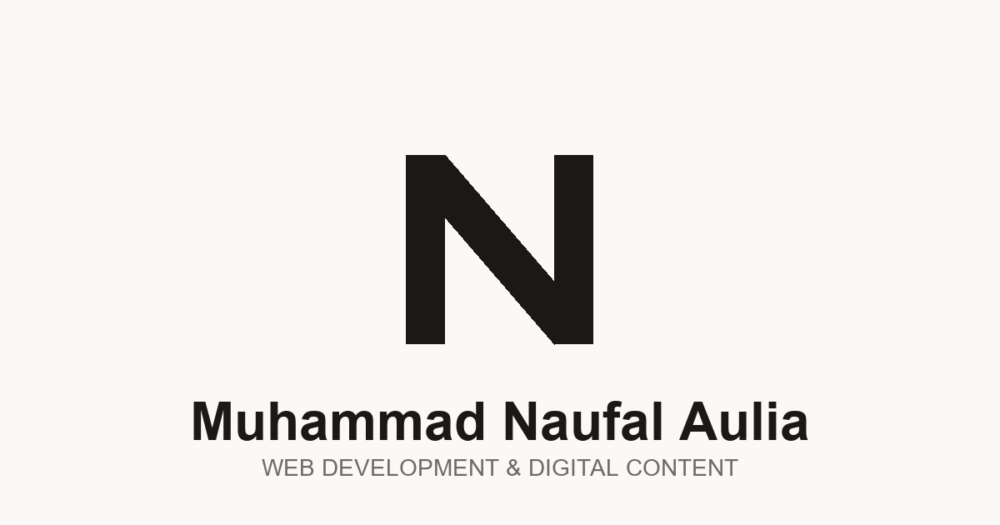

# Muhammad Naufal Aulia — Portfolio



Minimalist single-page portfolio. Monochrome palette, editorial typography,
subtle motion. Dark by default, light mode included.

**Live:** https://mhmmd-naufl.pages.dev

## Features

- Case-study modals — per-project story, screenshot gallery, live demo links
- ⌘K command palette — jump to sections, toggle theme, copy email
- GSAP + ScrollTrigger motion synced with Lenis smooth scroll
- Custom cursor, scramble text, magnetic buttons, scroll progress
- PWA (offline) + print-ready ATS resume
- Local content editor at `#admin` (dev builds only)

## Stack

- React 18 · Vite · TypeScript · Tailwind CSS
- GSAP, Lenis, cmdk · View Transitions API · vite-plugin-pwa

## Run locally

```bash
npm install
npm run dev        # dev server — editor at /#admin
npm run build      # production build → dist/
npm run preview    # preview the build
npm run lint       # eslint, zero warnings
npm run format     # prettier write
```

## Project structure

```
src/
├── components/    # sections + interactions (Nav, Hero, WorkList, …)
├── data/content.ts  # all site copy — edit here
├── lib/           # theme, gsap/ScrollTrigger setup, supabase
└── index.css      # theme tokens + effects
public/projects/   # project screenshots
```

Content lives in `src/data/content.ts`. Project screenshots go in
`public/projects/` and are referenced via the `image`/`gallery` fields.

## Deploy

Push to `main` → Cloudflare Pages builds and deploys automatically.

## License

[MIT](LICENSE)
